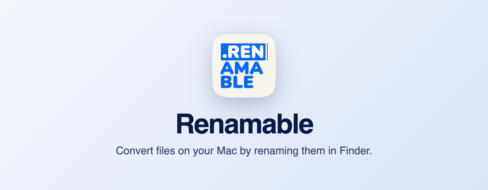
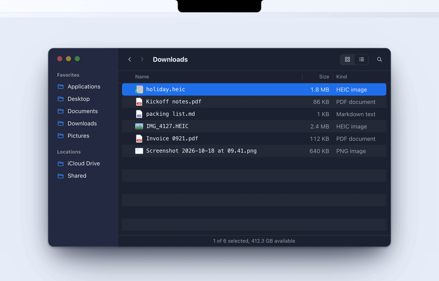

  

  

  
  

<strong>macOS 14+ · Apple silicon &amp; Intel · Signed &amp; notarized</strong> Free for 14 days. Pay once, no subscription.

Renamable converts a file when you change its extension in Finder. Rename `holiday.heic` to `holiday.jpg` and you get a real JPEG. No app to open, nothing to upload.

This is the public home for **downloads, bug reports and ideas**. The app is closed source.

## Rename it. That's it.

1. Click a file's name in Finder and change the ending, like `.docx` to `.pdf`.
2. Renamable converts it right there. A small message at the top of the screen says it's done.
3. Changed your mind? Press **Undo**, or rename it back. The original waits in the Trash.

## What it converts

Photos, documents, spreadsheets, slides, audio, video, archives, subtitles and data files. Over 100 formats, all on your Mac.

[See every format →](https://renamable.app/formats/)

## Safe by default

- **Your original is never lost.** It goes to the Trash, or stays next to the new file if you prefer.
- **Nothing is uploaded.** Every conversion happens on your Mac.
- **Only the folders you choose.** Desktop, Documents and Downloads to start, plus any folder you add.
- **Hidden files are left alone.** Renamable only acts on renames you make in Finder.

## Price

Try the full app free for 14 days, no card needed. Then pay once for 1 Mac or 3 Macs, with free updates. [See pricing →](https://renamable.app/pricing/)

Make a video about Renamable and get up to 100% back. [How it works →](https://renamable.app/discount/)

## Help make Renamable better

Found something broken? Missing a format you need? I'd love to hear it.

| What's on your mind? | Start here |
| --- | --- |
| Something isn't working | [Report a bug](https://github.com/ruban-24/renamable-releases/issues/new?template=bug_report.yml) |
| A format you'd like | [Request a format](https://github.com/ruban-24/renamable-releases/issues/new?template=format_request.yml) |
| What you like, what could be better | [Share feedback](https://github.com/ruban-24/renamable-releases/issues/new?template=feedback.yml) |

[Browse existing issues](https://github.com/ruban-24/renamable-releases/issues) first. If someone already asked, add a 👍 there. Suggestions are welcome but aren't a promise.

**License, purchase or private help?** Email [support@renamable.app](mailto:support@renamable.app). Please keep license keys, receipts and personal files out of public issues. You can also [find your key or free a Mac](https://polar.sh/renamable/portal).

---

[Website](https://renamable.app) · [Download](https://renamable.app/download/) · [Release notes](https://github.com/ruban-24/renamable-releases/releases) · [Privacy](https://renamable.app/privacy/) · [Support](https://renamable.app/support/)

Made by [Ruban](https://github.com/ruban-24).
